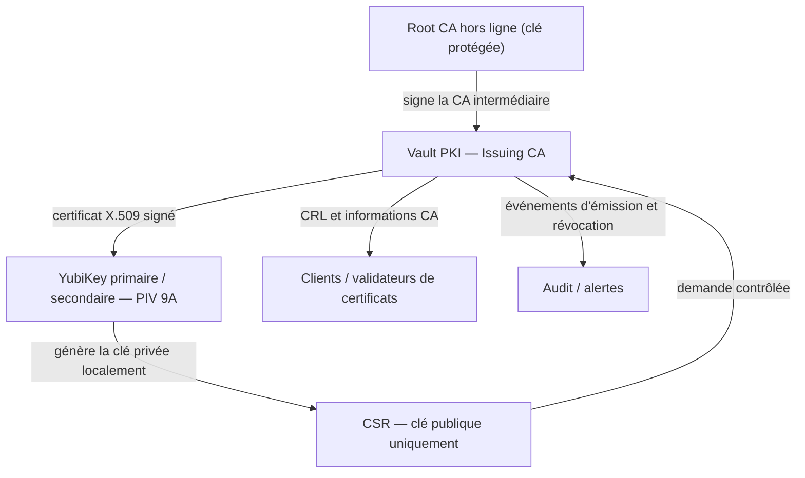

# Roadmap — certificats YubiKey PIV avec HashiCorp Vault PKI

Statut : **proposition, non déployée** (2026-11-02). Aucun certificat, slot, PIN/PUK ou secret n'est modifié par cette documentation.

## Architecture cible

**Frontière de sécurité :** la clé privée PIV reste dans la YubiKey ; Vault signe une CSR et ne reçoit jamais la clé privée. Deux YubiKey = deux clés privées indépendantes et deux certificats distincts. Le certificat professionnel doit rester sous la gouvernance de la PKI d'entreprise ; ne jamais importer une CA personnelle dans Entra ID sans validation IAM.

## Priorités et critères de fin

| Priorité | Travail | Validation / Done |
| --- | --- | --- |
| P0 | Inventaire **read-only** des slots PIV 9A/9C/9D/9E et 82–95, des certificats présents, issuer, SAN/EKU, serial, validité, CRL/CDP et attestation ; aucune donnée sensible committée | Rapport anonymisé par clé, distinction `certificat présent` / `clé possible` / `inconnu`, tests hermétiques |
| P1 | ADR de confiance PKI : Root CA hors ligne, CA intermédiaire Vault, politiques de noms/EKU, rôles de signature, TTL, endpoints CA/CRL, sauvegarde/reprise, ACL et audit | ADR approuvée, CA et CRL validées **en labo isolé**, aucun déploiement de confiance implicite |
| P2 | Prototype `ykman`/PKCS#11 : clé générée **sur la clé** ; CSR ; `pki/sign/<role>` ; import du seul certificat public, avec confirmation explicite | Tests avec clé de test uniquement, chaîne X.509 et non-exportabilité vérifiées |
| P3 | Automatisation d'alertes J-60/J-30/J-7, renouvellement contrôlé, révocation et publication CRL ; inventaire sans identifiants personnels publics | Scénarios expiration, perte et refus après révocation testés ; audit corrélé |
| P4 | Runbooks de reprise : perte de la clé, remplacement, backup de la CA, indisponibilité Vault et restauration des données chiffrées ; publication de la vue architecturale dans `nabla-site-alban` | Exercices documentés et vérifiés, aucune clé privée dans Git, logs ou Vault PKI |

## Décisions et garde-fous

- Le slot **9A** est réservé à l'authentification ; **9C** à la signature ; **9D** à la gestion de clé/chiffrement ; **9E** à l'authentification carte. Les slots 82–95 sont « retired key management » : ne pas les présenter comme des slots d'identité Entra CBA interchangeables.
- Ne pas déduire qu'un slot contient une clé de la seule absence de certificat X.509.
- Vérifier les limitations algorithmiques, la prise en charge des PIN/PUK, le middleware et les règles d'association avant tout essai Entra CBA.
- Ne pas écraser le certificat 9A existant, l'attestation F9 ni la clé de gestion PIV ; toutes les écritures nécessitent une approbation explicite par action.
- Vault PKI n'est pas le gestionnaire matériel PIV : `ykman` ou PKCS#11 assure l'interface locale.
- Pour **9D**, une clé privée non exportable perdue peut rendre des données indéchiffrables : établir une politique de récupération avant d'utiliser ce slot.
- Les URL CRL doivent être atteignables par les validateurs cibles ; tester révocation, cache et indisponibilité.
- Les backups de la CA (et procédures unseal/restore Vault) doivent être chiffrés, séparés et vérifiés ; ne jamais publier les secrets ni l'inventaire nominatif dans ce dépôt public.

## Sources

- [Vault PKI](https://developer.hashicorp.com/vault/docs/secrets/pki)
- [Yubico — slots PIV](https://developers.yubico.com/PIV/Introduction/Certificate_slots.html)
- [Microsoft — Entra CBA](https://learn.microsoft.com/en-us/entra/identity/authentication/how-to-certificate-based-authentication)
